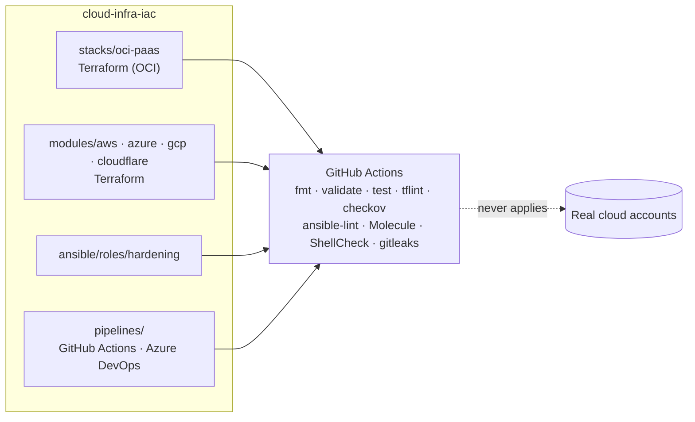
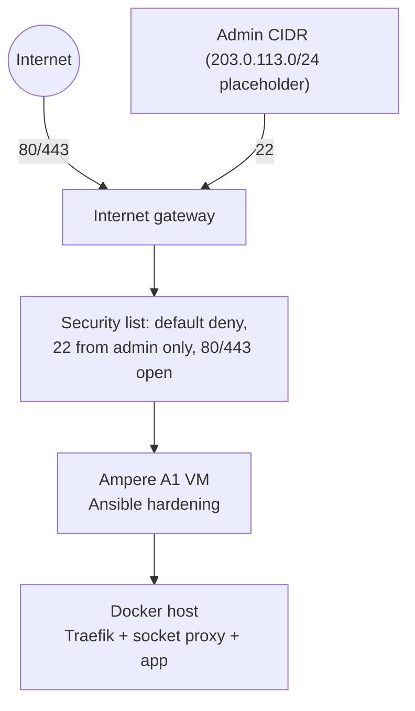

# cloud-infra-iac


Infrastructure-as-code reference by **DC TECH INC**: an Oracle Cloud (OCI) PaaS stack, small AWS / Azure / GCP / Cloudflare modules, an Ansible hardening role tested with Molecule, and CI pipelines for GitHub Actions and Azure DevOps.

> **Nothing in this repository has been applied to a real cloud account.** There are no cloud credentials, no real IP addresses and no real domains here (only `example.com` and RFC 5737 documentation ranges). Correctness is demonstrated by `terraform fmt`, `validate`, `terraform test` with mock providers, tflint, checkov, ansible-lint and Molecule, all running in CI. Treat the modules as reviewed reference code, not as battle-tested production infrastructure.

## What it shows

| Area | Where | Proof in CI |
|---|---|---|
| OCI network + ARM VM + security lists, PaaS-style Docker host | [`stacks/oci-paas`](stacks/oci-paas) | fmt, validate, mock-provider tests, checkov |
| AWS VPC + ALB + S3, Azure VNet + LB + Storage, GCP VPC + HTTP LB + bucket | [`modules/aws`](modules/aws), [`modules/azure`](modules/azure), [`modules/gcp`](modules/gcp) | same |
| Cloudflare DNS / CDN settings / R2 bucket | [`modules/cloudflare`](modules/cloudflare) | same |
| Server hardening (sshd, fail2ban, unattended upgrades, sysctl) | [`ansible`](ansible) | ansible-lint + Molecule on Docker |
| Pipelines | [`pipelines/github-actions`](pipelines/github-actions), [`pipelines/azure-devops`](pipelines/azure-devops), [`.github/workflows/ci.yml`](.github/workflows/ci.yml) | schema validation (`check-jsonschema`), yamllint |
| Bash tooling | [`scripts`](scripts) | ShellCheck |
| Secret hygiene | whole history | gitleaks (pinned release, sha256-verified download) |

## Architecture



The OCI stack, step by step:



## Run it locally

You need Terraform 1.9+ and nothing else (no cloud login):

```bash
scripts/validate-all.sh
```

That runs `fmt -check`, `init -backend=false`, `validate` and `terraform test` for every root. The tests use [`mock_provider`](https://developer.hashicorp.com/terraform/language/tests/mocking), so no account is contacted.

Ansible role (needs Docker for the Molecule driver):

```bash
pip install -r requirements-ci.txt
cd ansible/roles/hardening && molecule test
```

Compose host (on a VM, after copying `stacks/oci-paas/paas/.env.example` to `.env`):

```bash
docker compose -f stacks/oci-paas/paas/compose.yaml up -d
```

## Design decisions

Short ADRs live in [`docs/adr`](docs/adr):

1. [One repo for OCI and multi-cloud IaC](docs/adr/0001-single-iac-repo.md)
2. [Validate and test, never apply](docs/adr/0002-validate-never-apply.md)
3. [Molecule on Docker for hardening](docs/adr/0003-molecule-on-docker.md)

The security baseline and the list of accepted scanner findings are in [`docs/security-baseline.md`](docs/security-baseline.md).

## Provider and tool documentation used

Resource arguments were written against the official docs of the pinned provider versions:

- Oracle OCI provider: <https://registry.terraform.io/providers/oracle/oci/latest/docs>
- AWS provider: <https://registry.terraform.io/providers/hashicorp/aws/latest/docs>
- AzureRM provider: <https://registry.terraform.io/providers/hashicorp/azurerm/latest/docs>
- Google provider: <https://registry.terraform.io/providers/hashicorp/google/latest/docs>
- Cloudflare provider (4.x): <https://registry.terraform.io/providers/cloudflare/cloudflare/4.52.0/docs>
- Terraform tests and mocking: <https://developer.hashicorp.com/terraform/language/tests>
- Azure Pipelines YAML schema: <https://learn.microsoft.com/azure/devops/pipelines/yaml-schema/>
- Docker Compose: <https://docs.docker.com/compose/>

## Limitations (honest list)

- No `apply` has ever been run; real-account behaviour (quotas, image availability, IAM, billing) is untested.
- Mock-provider tests only assert values derived from the configuration; computed values (IDs, IPs) are random mock data.
- The Azure DevOps pipeline is schema-validated only; it has not run on an Azure DevOps organization.
- The Molecule scenario runs in a container, so it cannot exercise services, `sysctl` or reboots; those handlers are skipped there by design.
- State is local-only in this reference. Remote state and locking are described in the ADRs but not configured.
- Modules are intentionally small (network, load balancer, bucket). They are not a landing zone.

## Roadmap

Tracked as issues: remote state example, an OCI Object Storage backend, and a Terraform `plan`-only job gated on repository variables. Contributions are described in [CONTRIBUTING.md](CONTRIBUTING.md); report vulnerabilities as described in [SECURITY.md](SECURITY.md).

## License

MIT, Copyright (c) 2026 DC TECH INC.
